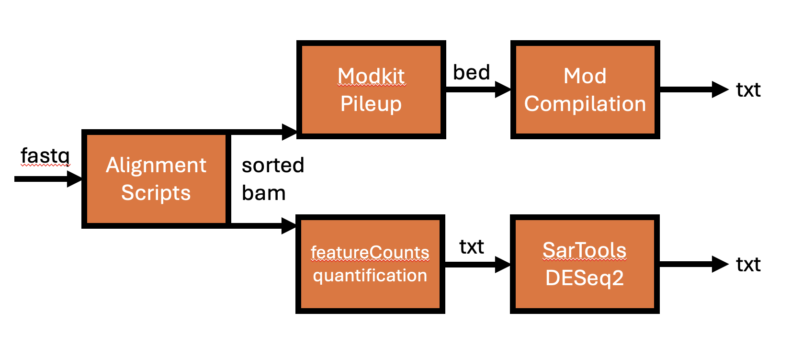

# Direct RNA Nanopore Analysis Pipeline to Examine METTL3 Inhibitor Resistance

This repository contains pipelines for alignment, base modification calling, and differential expression analysis of **Nanopore direct RNA sequencing data** from THP-1 leukemia cells treated with METTL3 inhibitors and/or YTHDC1 overexpression.

**Figure 1. Workflow for Nanopore Direct-RNA Sequencing Analysis in Kharas-Storm Repository.**  


All pipelines were developed in the **Mason Laboratory (WCM)**.

---

## Study Overview

Nanopore direct RNA sequencing was used to characterize **m⁶A and other base modifications** in THP-1 cell lines under four experimental conditions:

| Condition | Replicates | Description |
|------------|-------------|-------------|
| THP1 GFP DMSO 48 h | 3 | Control (untreated) |
| THP1 GFP STM2457 15 µM 48 h | 3 | METTL3 inhibitor treatment |
| THP1 GFP-YTHDC1 DMSO 48 h | 3 | YTHDC1 overexpression |
| THP1 GFP-YTHDC1 STM2457 15 µM 48 h | 3 | Combined YTHDC1 + METTL3i |

Sequencing was performed on **Oxford Nanopore PromethION** (Study ERP182419, ENA project PRJEB100992, submission 2025-10-29). All analyses use the same naming convention as the raw sample metadata (as documented in `THP1_GFP-YTHDC1 OE_STM_48H_05202025.xlsx`).

---

## Repository Structure

```
Kharas-Storm/
├── Alignments_Pipeline/                # Alignment and Modkit Summarization of multi-mod Dorado-basecalled reads
│   ├── mods-alignment-from-folder.sbatch
│   └── Modkit_Scripts_Logs/
│       └── [sample folders + sbatch + logs]
│
├── Mod_Compilation_Pipeline/           # Modkit post-processing and z-score filtering
│   ├── run_full_pipeline.sbatch
│   ├── scripts/
│   │   ├── 01_filter_beds.py
│   │   ├── 02_generate_union_beds.sbatch
│   │   ├── 03_intersect_with_union.sbatch
│   │   ├── 04_merge_to_matrix.py
│   │   ├── 05_filter_by_zscore.py
│   │   ├── 06_summarize_pipeline_stats.py
│   │   ├── 07_annotate_outputs_with_genes.sh
│   │   └── filter_bed_sites.py
│   └── outputs/
│       ├── filtered_beds/
│       ├── union_beds/
│       ├── merged_matrix/
│       ├── zscore_filtered/
│       └── annotated TSVs per modification
│
├── DGE_Analysis_Pipeline/              # SARTools + DESeq2 RNA-seq differential analysis
│   ├── Kharas_SarTools_DESeq2_Analysis/
│   │   ├── target_kharas.txt
│   │   ├── raw/ (featureCounts output)
│   │   └── DESeq2 for Kharas THP1 DC1_Report.html
│   └── SARToolsScript.R
│
└── Plots/                              # Figure generation scripts (Extended Fig 9A, Fig 5B)
```

---

## Pipeline Summaries

### 1. **Alignments Pipeline**

Automates alignment of **basecalled multi-mod BAMs** to the reference genome and submits per-modification `modkit` jobs.

**Key script:**  
`mods-alignment-from-folder.sbatch`

**Steps**
1. Convert `calls_*.bam` → FASTQ via `samtools fastq`
2. Align to reference using `minimap2 -ax splice -uf -k14`
3. Sort + index BAMs with `samtools`
4. Run `modkit pileup` + `modkit summary` per modification code  
   (A/m⁶A → `a`, m⁵C → `m`, inosine/m⁶A → `17596`, etc.)

**Usage**
```bash
sbatch mods-alignment-from-folder.sbatch <reference_genome.fa> <input_folder>
```

---

### 2. **Mod Compilation Pipeline**

Aggregates, filters, and annotates **per-base modification calls** across samples.

**Primary driver:**  
`run_full_pipeline.sbatch`

**Major stages**
1. **Filter BEDs:** apply coverage + stoichiometry criteria (`filter_bed_sites.py`)  
2. **Generate union sites:** merge all samples per modification  
3. **Intersect union × sample BEDs:** retain shared sites with attributes  
4. **Merge to long/wide matrices:** `04_merge_to_matrix.py`  
5. **Compute z-scores:** per-site, per-sample modification ratios (`05_filter_by_zscore.py`)  
6. **Summarize + annotate:** site statistics and gene mapping via `bedtools intersect`

**Run example**
```bash
sbatch run_full_pipeline.sbatch /path/to/project_root sample_list.txt
```

**Output Highlights**
- `*_merged_union_matrix_wide__with_z.tsv`  
  — per-site wide matrix with z-scores across all samples  
- `*_z_gt3.0_annotated.tsv`  
  — filtered sites where any z > 3  
- `stats/*.txt` — summary counts per mod type  

---

### 3. **Differential Gene Expression (DGE) Pipeline**

Performs DESeq2 analysis of gene-level counts (e.g. featureCounts) with **SARTools** reporting.

**Script:**  
`SARToolsScript.R`

**Key Parameters**
```r
projectName <- "DESeq2 for Kharas THP1 DC1"
condRef <- "THP1GFPDMSO48h"
alpha <- 0.05
pAdjustMethod <- "BH"
typeTrans <- "VST"
```

**Run in R**
```r
source("SARToolsScript.R")
```

Generates a full HTML report with QC plots, PCA, MA plots, and differential gene tables.

---

## Dependencies

Software versions used for both alignment and modification pipelines:

- `samtools=1.21` (bioconda), `htslib=1.21`
- `bedtools=2.31.1` (bioconda)
- `python=3.12`
- `pandas`, `numpy` (>=2.3)
- `minimap2` (>=2.28; separate env recommended)
- `modkit=0.5.x` (ONT prebuilt binary)
- plus: `bedtools`, `curl`, `graphviz`, `imagemagick` (for QA/report figures)

All pipelines are SLURM-based and were run on the **Cornell Cayuga Cluster** nodes.

---

## Data Availability

Raw direct RNA sequencing data are deposited under:

| Accession | Instrument | Study | Submission Date | 
|------------|-------------|--------|----------------|
| **PRJEB100992 / ERP182419** | ONT PromethION | “Nuclear Condensates Drive Adaptive Resistance to METTL3 Inhibition” | 2025‑10‑29 |

Sample metadata (RNA concentrations and QC ratios) for 12 THP-1 libraries analyzed here are provided in `THP1_GFP-YTHDC1 OE_STM_48H_05202025.xlsx`.

---

## Citation

**Citation TBD**  

---

For questions, please contact **Theo Nelson** (thn4005@med.cornell.edu).


